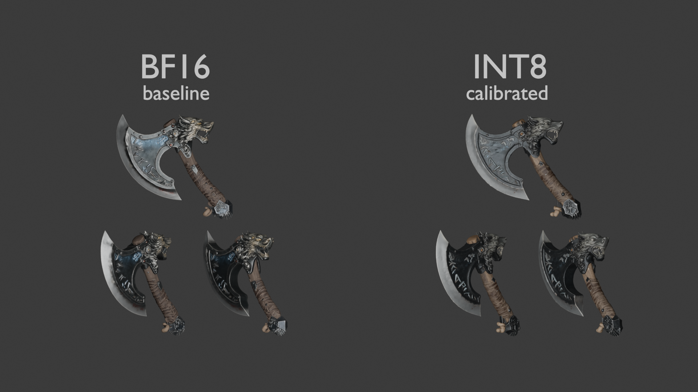
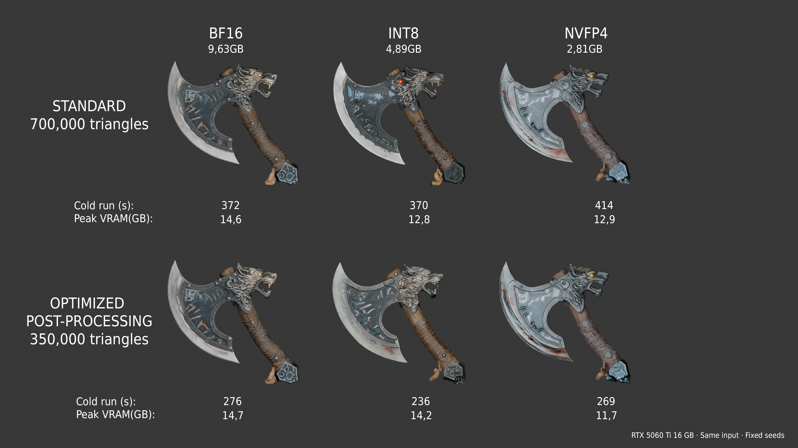
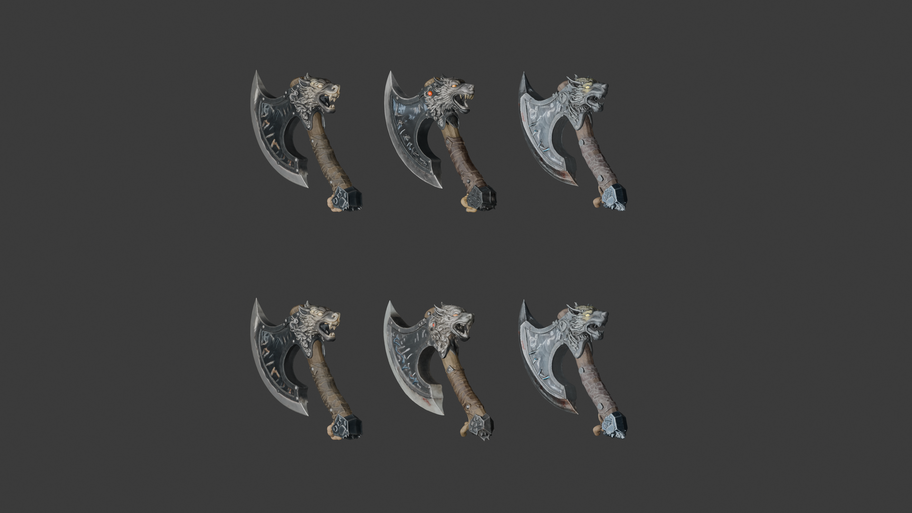
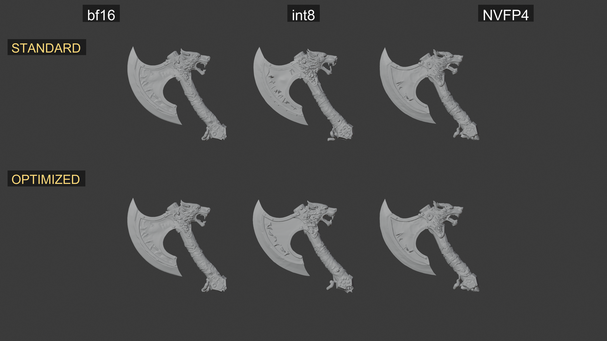

# TRELLIS.2 quantization study (bf16 vs int8 vs naive fp8)

Preliminary, non-benchmark study of ComfyUI TRELLIS.2 DiT weight dtypes:
bf16 baseline, a calibrated int8 checkpoint (third-party), and a naive fp8 cast
produced in this repo.

- **This is not a quality leaderboard.** Numbers are from one machine, one
  workflow, seeds 56 / 42 / 43. Treat them as a diagnostic record, not a claim
  that one dtype is "best".
- Model weights are **not** stored in this repository.
- All meshes in this study come from a single input image — the main scope
  limitation.

## Key findings

- int8 calibrated ≈ bf16 visually on 3 seeds (KSampler shape 91 → 66 s),
  end-to-end roughly equal (371 vs 373 s cold); post-processing dominates.
- Naive fp8 crashes at load (unet_dtype vs supported dtypes) — reported
  upstream as [Comfy-Org/ComfyUI#16827](https://github.com/Comfy-Org/ComfyUI/issues/16827).
- NVFP4 4-bit (ours, 2.81 GB) loads via ComfyUI's quantized-weights path and
  generates; not faster end-to-end here.
- Post-processing tuning (AO 512/32, remesh 512, tex 2K, decimate 350K) cut
  cold wall time by 26–36% depending on model.
- Blade defect is seed-dependent; remesh 512 heals it on the tested seeds
  (details: [docs/perf-study.md](docs/perf-study.md)).

## Task

Image → 3D mesh with ComfyUI TRELLIS.2 / Pixal3D workflow. Compare:

| Variant | Origin | Weights |
|---------|--------|---------|
| bf16 baseline | Comfy-Org TRELLIS.2 | `trellis_2_bf16` (reference) |
| int8 (calibrated) | Comfy-Org, third-party quant | `trellis_2_int8_convrot` |
| fp8 (naive) | **This repo** (`scripts/quant_bf16_to_fp8.py`) | cast 2D `*.weight` → `float8_e4m3fn`, no scale |

Naive fp8 is a diagnostic cast, not a production quantization method.

## Environment

| Item | Value |
|------|--------|
| ComfyUI (bf16/int8 battle) | `3dd559d81f745747cab884a3b9f5fd8867d79efe` (2026-09-20) |
| ComfyUI (fp8 crash repro) | `b0b743566f65daafc423b4fea8a2fbda94b3384a` (v0.39.0, 2026-10-05), `--disable-all-custom-nodes` |
| Python | 3.12.10 (battle) / 3.13.14 (crash repro) |
| PyTorch | 2.12.1+cu130 (battle) / 2.14.0+cu130 (crash repro) |
| CUDA | 13.0 |
| GPU | NVIDIA GeForce RTX 5060 Ti, 16 GB |
| Driver | 616.92 |
| OS | Windows |

## Input image

Workflow node `LoadImage` (node id **122**) expects `viking_wolf_rune_axe.png`
in ComfyUI's `input/` folder. The file is **not** shipped in this repository —
download it from the official Comfy-Org template:

  https://raw.githubusercontent.com/Comfy-Org/workflow_templates/refs/heads/main/input/viking_wolf_rune_axe.png

Any clean product-style object image works under that filename. See
`NOTICE.md` for the test-asset terms.

## Models required by the workflow

Place files under `ComfyUI/models/` (see workflow metadata for HF URLs):

| Folder | File (example) |
|--------|----------------|
| `diffusion_models/` | `trellis_2_bf16.safetensors` or `trellis_2_int8_convrot.safetensors` |
| `vae/` | `trellis_2_shape_vae_bf16.safetensors`, `trellis_2_texture_vae_bf16.safetensors` |
| `clip_vision/` | `dino_v3_L_naf_fp32.safetensors` |
| `geometry_estimation/` | `moge_2_vitl_normal_fp16.safetensors` |
| `background_removal/` | `birefnet.safetensors` |

**bf16 vs int8 switch** (saved graph node ids):

| Node id | Type | Saved value | Role |
|---------|------|-------------|------|
| **40** | `UNETLoader` | `trellis_2_int8_convrot.safetensors`, `weight_dtype=default` | shape / structure DiT — swap to `trellis_2_bf16.safetensors` for baseline |
| **319** | `UNETLoader` | `trellis_2_int8_convrot.safetensors`, `weight_dtype=default` | inactive Trellis branch input (retargeted from `pixal3d_int8_convrot.safetensors`, which is not installed; the loader file must exist or queue validation rejects the prompt) |
| **122** | `LoadImage` | `viking_wolf_rune_axe.png` | input image |
| **316** | `PrimitiveBoolean` | `true` — “Switch to Trellis2” (title in UI) | `true` routes switches 314/315/318 to the Trellis.2 branch (node 40 + `Trellis2Conditioning`); `false` would select the Pixal3D branch (inactive, model not installed) |

The saved workflow ships with **int8** unet names selected. For the bf16 baseline
run, set node **40** `unet_name` to `trellis_2_bf16.safetensors` (and texture unet
if you also compare that stage). `weight_dtype` was left as `default` in both runs.

### Sampler settings (from the saved workflow)

| Stage (approx.) | steps | cfg | sampler | scheduler |
|-----------------|-------|-----|---------|-----------|
| structure | 12 | 1.0 | euler | normal |
| img2shape | 12 | 7.5 | euler | normal |
| shape refine / other | 20 | 7.5 | euler | normal |
| texture / other | 12 | 7.5 | euler | simple |

Resolution 1024×1024. Per-seed logs were not retained; the table below is the
aggregate record from the study runs.

## Results (seeds 56 / 42 / 43, one workflow)

| Metric | bf16 baseline | int8 calibrated |
|--------|---------------|-----------------|
| KSampler time (shape) | ~91 s | ~66 s |
| Full prompt time | 292.31 s | 277.77 s |
| Staged VRAM (approx., from run logs) | 9854 MB | 5004 MB |
| Mesh vertices | 6.49 M | 7.66 M |
| Load / crash | OK | OK |
| Visual result | reference | **visually comparable** on these seeds |

VRAM numbers are approximate values recorded during the runs; we did not
re-measure with an external profiler for this repo.



*Left: bf16 baseline. Right: calibrated int8. Three seeds / views per side.*

Visual comparison: on these three seeds the meshes are **visually comparable**
(same object, same overall quality; minor surface/rune differences). This is
**not** a claim that int8 ≡ bf16 in general — only what we observed here.

Post-processing time (~210 s) is excluded from the KSampler numbers above.

### fp8 (naive) — not measured as a full run

| Metric | fp8 naive |
|--------|-----------|
| Load in ComfyUI | **Crashes** at model init (see below) |
| KSampler / VRAM / mesh | **Not obtained** |

fp8 was not included as a third row in the mesh comparison because no valid mesh
was produced. See [docs/upstream-issue.md](docs/upstream-issue.md).

## Performance study

Bottleneck map and speedup levers for the full pipeline (see
[docs/perf-study.md](docs/perf-study.md) for method, per-node tables and
evidence). Cold full runs on the same machine (Blender closed, fresh server).
Battle rows above ran on ComfyUI 3dd559d8 + torch 2.12; rows below on
b0b74356 + torch 2.14 — cross-table deltas mix env change with dtype effects.
Vertex counts are scale context, not a quality metric.

| Metric | int8 (calibrated) | NVFP4 (this study) | bf16 |
|--------|-------------------|--------------------|------|
| Checkpoint | 4.89 GB | **2.81 GB** | 9.63 GB |
| Cold full run | **370.8 s** | 414.3 s | 372.6 s |
| Cold full run, optimized combo | **236.8 s** | 269.7 s | 276.8 s |
| Cold full run, `--use-sage-attention` | **331.7 s** (int8) | — | — |
| Hot rerun (cache) | 0.1 s | 0.1 s | 0.3 s |
| Peak VRAM, standard / combo (cold) | 80.1% / 89.3% | 81.0% / **73.5%** | 91.5% / 92.6% |
| Shape mesh verts | 7.82M | 9.79M | 7.87M |

Visual comparison (Blender, same light/camera — standard vs optimized rows,
bf16/int8/NVFP4 columns, textured + clay):





On seed set A, int8/bf16 meshes lost blade chunks at remesh768 while NVFP4
stayed whole; remesh512 healed int8 (2 runs) and bf16 (1 run) — small sample.
A different seed set gave whole blades at 768 too, so the defect is
seed-dependent, not a quant verdict (details: [docs/perf-study.md](docs/perf-study.md)).

Findings: sampling is only ~30% of the time; the mesh/texture post-processing
dominates. Cheap wins: AO bake 1024/64 → 512/32 (−55 s), Remesh 768 → 512
(~−41 s combined). NVFP4 4-bit DiT (`scripts/quant_bf16_to_nvfp4.py`, 840
layers) loads in ~1 s through the quantized-weights path and generates a
valid dense mesh. Naive fp8 fails at load on stock ComfyUI; with a one-line
local patch it loads but the structure stage returned empty (cause not
isolated) — so the two are not directly comparable; final visual verdict
pending.

## Reproduction

### 1. Standalone scripts (no ComfyUI — `requirements.txt` suffices)

```bash
pip install -r requirements.txt

# Naive fp8 cast (needs ~20+ GB free RAM and disk for input+output)
python scripts/quant_bf16_to_fp8.py path/to/trellis_2_bf16.safetensors path/to/trellis_2_fp8_naive.safetensors

# Compare two checkpoints (prints metrics; optional CSV)
python scripts/compare_weights.py path/to/trellis_2_bf16.safetensors path/to/trellis_2_fp8_naive.safetensors --csv results/weight_damage.csv
```

### 1b. ComfyUI-dependent scripts (NOT covered by `requirements.txt`)

Run these with ComfyUI's embedded Python:

```bash
# NVFP4 quantization: needs `comfy` (comfy.quant_ops), a comfy-kitchen build
# with NVFP4 support, and a Blackwell (or newer) GPU
python scripts/quant_bf16_to_nvfp4.py path/to/trellis_2_bf16.safetensors path/to/trellis_2_nvfp4.safetensors --ref path/to/trellis_2_int8_convrot.safetensors

# Profiler: needs aiohttp (ships with ComfyUI); --gpu needs nvidia-smi
python scripts/profile_workflow.py --run workflows/trellis2_image_to_model.api.json --csv results/timings/run.csv --gpu
```

### 2. ComfyUI workflow (meshes)

1. Install ComfyUI (battle used commit `3dd559d8`; fp8 crash repro confirmed on `b0b74356` / v0.39.0).
2. Download models listed above into `ComfyUI/models/...`.
3. Put the input image into `ComfyUI/input/viking_wolf_rune_axe.png`.
4. Open `workflows/trellis2_image_to_model.json`.
5. Select bf16 or int8 diffusion model; queue; compare meshes.

## FP8 failure analysis

### What we did

1. Cast bf16 2D `*.weight` tensors → `float8_e4m3fn` with no scale factors
   (`scripts/quant_bf16_to_fp8.py`). File ~5.2 GB vs ~10.3 GB bf16.
2. Load through normal ComfyUI diffusion-model path.

### Crash

Reproduced on a fresh ComfyUI portable install at `b0b74356` (v0.39.0) with
`--disable-all-custom-nodes`: `Load Diffusion Model` → `NotImplementedError`
on `torch.arange` for `float8_e4m3fn`.

ComfyUI returns fp8 as the unet dtype when the checkpoint is fp8 and the GPU
supports fp8 compute, even though `Trellis2.supported_inference_dtypes` is
`[bfloat16, float32]`. `SparseStructureFlowModel.__init__` then calls
`torch.arange(..., dtype=fp8)`, which PyTorch does not implement.

Full traceback, environment, and suggested fixes:
[docs/upstream-issue.md](docs/upstream-issue.md).

### Weight damage (naive cast vs bf16)

Metrics from `scripts/compare_weights.py` on the actual study checkpoints
(`results/weight_damage.csv`). **Layer names below are the exact state-dict
keys** used in the CSV and in `compare_weights.py` `LAYERS` (ComfyUI prefix
`model.` included):

| Layer (state-dict key) | mae / mean\|ref\| | zero bf16 | zero fp8 | new zero (fp8 only) |
|------------------------|-------------------|-----------|----------|---------------------|
| `model.structure_model.t_embedder.mlp.0.weight` | 0.064 | 0.000 | 0.152 | **0.152** |
| `model.structure_model.blocks.0.self_attn.to_qkv.weight` | 0.037 | 0.000 | 0.067 | **0.067** |
| `model.structure_model.blocks.0.self_attn.to_out.weight` | 0.042 | 0.000 | 0.062 | **0.062** |
| `model.structure_model.adaLN_modulation.1.weight` | 0.029 | 0.000 | 0.034 | **0.034** |
| `model.structure_model.input_layer.weight` | 0.023 | 0.000 | 0.003 | **0.003** |
| `model.structure_model.out_layer.weight` | 0.032 | 0.000 | 0.034 | **0.034** |
| `model.img2shape.input_layer.weight` | 0.022 | 0.000 | 0.006 | **0.006** |
| `model.img2shape.out_layer.weight` | 0.026 | 0.000 | 0.021 | **0.021** |

**Metric definition:** `mae / mean|ref| = mean(|x − ref|) / mean(|ref|)`.
This is **not** an L2 relative error. `new_zero_frac` = fraction of elements
that are exactly zero in fp8 but not zero in bf16.

**Finding:** in these layers the bf16 tensors have essentially **no exact
zeros**; the naive fp8 cast **introduces** zeros (up to ~15% in
`model.structure_model.t_embedder.mlp.0.weight`). That is consistent with
small-magnitude weights underflowing e4m3 without scale factors. The load
crash itself is dtype plumbing and does **not** depend on weight values.

### Local experiment (not a fix)

With a local one-liner forcing RoPE coordinate dtype to a supported type, the
model constructed and sampling started. The structure stage then produced an
empty coordinate layout (`Trellis2 coords can't be empty`). Cause **not**
asserted; may or may not relate to naive fp8 weights. The patch was **reverted**
and is not shipped as a fix. A similar one-line RoPE-dtype patch was
independently proposed in [PR #16828](https://github.com/Comfy-Org/ComfyUI/pull/16828).

## What is mine vs third-party

| Artifact | Origin |
|----------|--------|
| Naive fp8 script + weight-damage analysis | This study |
| bf16 / int8 meshes, timings, VRAM | Local runs of this study |
| ComfyUI TRELLIS.2 runtime + workflow graph | Comfy-Org / community |
| Calibrated int8 checkpoint | Comfy-Org (`trellis_2_int8_convrot`) |
| Input test image | Official Comfy-Org template input (linked, not shipped — see Input image) |
| Bug report draft | This study → reported as [Comfy-Org/ComfyUI#16827](https://github.com/Comfy-Org/ComfyUI/issues/16827); fix proposed in [PR #16828](https://github.com/Comfy-Org/ComfyUI/pull/16828) by another contributor (open, awaiting maintainer review as of 2026-10-11) |

## Repository layout

```
scripts/
  quant_bf16_to_fp8.py            # research-only: 2D *.weight -> fp8_e4m3fn (CLI, no scale)
  quant_bf16_to_nvfp4.py          # research-only: 2D *.weight -> ComfyUI NVFP4 (CLI, per-tensor + block scales)
  compare_weights.py              # mae/mean|ref| + zero fractions between checkpoints
  profile_workflow.py             # per-node timing + VRAM profiler (--extract/--run/--list, --csv, --gpu)
  glbstats.py / silh.py           # mesh stats + silhouette renders (diagnostics)
  render_compare.py               # Blender 2x3 comparison scene (takes 6 GLB paths + 2 outputs, see --help)
  label_usergrid.py               # labels for results/compare_3quant_clay.png
workflows/
  trellis2_image_to_model.json    # canonical UI workflow (Trellis branch, 316=True)
  trellis2_image_to_model.api.json# captured API prompt (int8)
  exp/                            # experiment API prompts (numbering has gaps)
results/
  weight_damage.csv
  mesh_bf16_vs_int8.png
  compare_3quant_annotated.png / compare_3quant_angle2.png / compare_3quant_clay.png
  timings/                        # per-node CSVs + _gpu.csv VRAM logs (baseline, exp01-14, cold/hot)
  perf/                           # AO/texture comparison previews (downscaled, ≤2 MB each)
docs/
  upstream-issue.md               # draft issue for Comfy-Org/ComfyUI
  perf-study.md                   # bottleneck map, levers, NVFP4 study, final comparison
requirements.txt
LICENSE
NOTICE.md
.gitignore
```

## Licenses / terms

- Study scripts and docs: MIT (see `LICENSE`; third-party terms in `NOTICE.md`).
- TRELLIS.2, Pixal3D, ComfyUI, and model weights remain under their upstream
  licenses. This repo **does not** relicense them and does **not** redistribute
  weights.
- Workflow graph based on Comfy-Org templates — see those repositories for
  their terms (also noted in `NOTICE.md`).

## Disclosure

This repository was prepared with AI-assisted tooling (OpenCode). Numbers come
from local runs; the initial bf16/int8 comparison is an aggregate record
(per-seed logs were not retained), performance-study numbers come from logs in
`results/timings/` as stated inline. No results are invented.
If something looks off, open an issue or PR.

## Next steps

- The repository and upstream bug report are published.
- Performance study done (bottleneck map, AO/remesh wins, NVFP4 4-bit end-to-end).
- SageAttention 2.2.0 tested: sampling ~35% faster (KSampler 23: 63 → 41 s,
  full int8 cold 371 → 332 s), geometry defect pattern unchanged
  (see `docs/perf-study.md`). torch.compile on the DiT not tried.
- Open (future work): final visual verdict on NVFP4 texture maps;
  torch.compile experiment; KSampler-23 (63–83 s) remains the largest
  single stage. Comparisons and measurements are published; these two
  items stay open.
